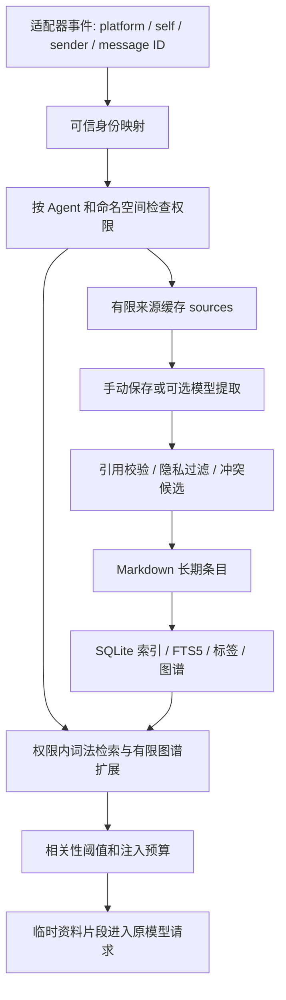

# 架构

所有搜索、图谱种子和扩展、缓存与写入都接受身份作用域检查。内部身份键按 HMAC 派生，条目元数据包含作用域签名；它们不能防止拥有文件密钥和宿主机权限的人修改数据。

Markdown 是长期条目的可读记录。SQLite 还包含未处理 sources、引用关系、审计摘要、批次与计数；它不是可以随意丢弃的纯缓存。遗忘摘要另外保存在 `.forgotten.json`，用于防止意外重新学习。

记忆只附加到相关请求的临时资料片段；不把整库拼入 system prompt，也不覆盖人格或历史。默认不调用 Embedding 服务。中文使用二元组预切词，英文使用词项；因此无法保证同义改写都有召回。

互聊停止保护使用独立的持久暂停标记与 generation：开始处理时记住代次，结束语导致代次变化，发送前阻止过期回复。它不提供对已发送内容的撤回，也不接管任意工具的直接发送。
